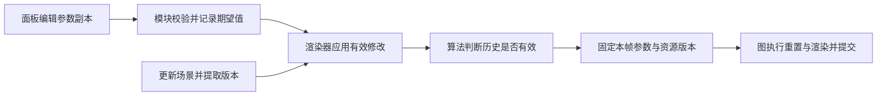

# MadCat 架构设计

更新日期：2026-10-27。本文整理项目既有架构约束及讨论中已经确认的设计方向，作为后续架构讨论的独立依据。设计不等于实现；实际能力、工具版本、构建命令和运行验证见[项目开发文档](project-development.md)及 [README](../README.md)。

## 文档职责与设计状态

| 文档 | 维护内容 |
|---|---|
| 本文 | 架构决定、模块职责、数据与资源所有权、运行流程、接口草案和待讨论事项 |
| [项目开发文档](project-development.md) | 开发目标、功能范围、实际进度、阶段计划和验收证据 |
| [协作约定](../AGENTS.md) | 仓库工作方式、阅读顺序和关键约束 |

“已确认”表示用户明确选择的方向或仓库既有约束；“设计基线／草案”表示为落实这些方向提出的流程和接口，仍需实际 Pass 验证；“待确认建议”保留先前方案的讨论依据。示例中的类型、函数和结构体均为目标用法，尚无对应的完整运行实现。

项目以 C++23、Windows 11、自研 ECS、Vulkan RHI 和 Slang 为基础，服务渲染研究工作流，优先正确性、机制可理解和可扩展。第一版由 C++ 组织 Pass，普通 Pass 尽可能通过 RHI 记录工作，图按声明处理依赖和同步；路径追踪包含多次散射、累积及变化重置。完整产品范围和阶段目标由开发文档维护。

既有架构约束包括：

- ECS 自行实现且不依赖 Vulkan，提供实体、组件和查询；Scene 管理局部与世界 Transform，维护有效父节点、拒绝层级环并明确删除行为。
- Assets 保存 CPU 资产，场景组件通过资产标识引用它们；RenderScene 派生 GPU 渲染数据，ECS System 与 Render Pass 分别承担场景更新和渲染工作。
- 当前 RHI 只面向 Vulkan；普通 Pass 尽量不暴露 Vulkan 类型，平台及 UI 后端适配集中放置。
- 图必须看见实际资源访问，包括 RenderScene 资源、加速结构和查看器；图外上传显式交接状态，反射不能代替访问声明。
- GPU 资源、Descriptor、上传内存与历史数据按相关 GPU 工作完成条件释放或复用；Shader 和图切换在安全边界应用，候选失败保留有效版本。
- 物理和动画的未来接入需要明确更新阶段与写入权，当前不实现求解、碰撞或骨骼动画。

## 已确认的架构决定

| 决定 | 约定 | 取舍与状态 |
|---|---|---|
| Pass 分阶段 | 声明、准备、执行；界面通过参数入口提交修改 | 生命周期清楚，作者需表达三个阶段；具体函数名仍为草案 |
| C++ 输入输出 | 明确的输入／输出结构和图资源句柄直接连接 | 编译器检查字段及基本资源类型，格式、尺寸和依赖仍由图检查 |
| 效果组合 | 一个算法模块可以组合多个图节点，中间结果对图及查看器可见 | 需要通过中间资源建立同步的步骤进入图，调用侧仍可只接收最终输出 |
| 显式槽位 | C++ 具名常量表达 set／binding，Shader 使用对应位置 | 初版两侧声明需成对维护；反射辅助生成或核对，保留显式控制 |
| 资源所有权 | 算法模块保留长期状态，图管理执行计划与中间资源，RenderScene 持有场景 GPU 数据 | 导入图不转移所有权；RHI 按实际完成条件执行释放与复用 |
| 参数与历史职责 | 界面提交修改，渲染器组织生效与本帧数据，算法判断历史失效，图执行重置与同步 | 参数快照、候选发布和计数规则已有场景推演，具体接口与实现仍待验证 |
| 图计划与执行版本 | 图计划可复用，各节点实际使用的准备版本、参数及资源引用在本帧固定 | 兼容的 Shader 更新可复用计划；固定粒度为一次帧执行，具体类型仍为草案 |
| 帧资源保活与回收 | RHI 在命令记录与提交流程中登记资源引用，提交后由帧上下文保留至相关工作完成 | 首个实现使用一个在途帧和明确等待；保活引用、完成标识及回收容器的具体实现待定 |

第一版采用 C++ 结构体连接和显式槽位；具名端口连接、按 Shader 资源名称绑定不是本版选定的公开写法。后续工具可以通过元数据映射到相同资源连接，避免形成第二套图执行语义。

算法模块表示可以保留参数及长期状态、组合图节点的算法单元；图节点表示一段有明确资源访问声明的 GPU 工作。下文的 Pass 编写示例围绕节点的声明／准备／执行展开，不要求一个完整效果对应一次 Draw 或 Dispatch。

## 模块边界和数据流

建议采用单进程、按职责拆分的 C++ 模块。目录和接口按当前实际需求逐步建立，不一次性生成全部框架。

| 模块 | 职责和数据所有权 | 主要依赖 |
|---|---|---|
| Core | 日志、错误、基础标识和通用工具 | 标准库 |
| Platform | 窗口、输入和平台事件 | Core、窗口库 |
| ECS | Entity、组件存储、查询和结构性修改 | Core |
| Scene | 场景组件、层级、Transform 更新和场景版本 | ECS、数学库 |
| Assets | CPU 模型、材质、图片及资源标识 | Core、模型与图片库 |
| Shader | Slang 编译产物、编译诊断和绑定布局元数据 | Core、Slang 工具或 API |
| RHI | GPU 资源、管线、绑定、命令和 GPU 生命周期 | Core、Shader 产物；内部依赖 Vulkan |
| RenderScene | 从 Scene 与 Assets 提取渲染数据、管理对应 GPU 数据 | Scene、Assets、RHI |
| RenderGraph | Pass 声明、依赖分析、图资源和同步计划 | Core、RHI |
| Passes | 阴影、基础光照、PBR、后处理、路径追踪等算法 | RenderGraph、RenderScene、RHI |
| Tools | 调参、Pass 开关、资源查看和编译操作 | 相应模块的公开接口 |
| Sandbox | 组装程序、示例场景和默认渲染图 | 上述模块 |

ECS 保存场景事实，例如局部 Transform、模型资源标识和灯光参数。世界矩阵由 Scene 计算，GPU 缓冲、材质表和光追实例表由 RenderScene 派生。ECS 不保存 `VkBuffer`、`VkImage`、Descriptor Set 或 Command Buffer。

**ECS System 与 Render Pass 是两种职责。** System 查询并更新场景状态；Pass 消费提取后的渲染数据并记录 GPU 工作。一个实体不对应一个 Pass，Render Graph 也不负责调度物理或动画。

建议每帧流程如下：

1. 处理窗口事件和界面输入，收集场景与参数修改。
2. 应用 ECS 结构性修改，执行场景系统，更新世界 Transform。
3. 提取本帧 RenderScene，准备上传数据，并更新场景、相机、材质版本。
4. 在图结构、输出尺寸或 Shader 接口变化时重新编译图；纯数值参数变化只更新参数数据。
5. 执行上传、必要的加速结构构建、渲染 Pass、调试显示和界面绘制，提交 GPU 工作并呈现。
6. 根据 GPU 完成信号回收可以释放或复用的资源。

第一阶段建议 CPU 系统顺序执行，GPU 渲染工作使用一个同时支持所需 Graphics、Compute 和 Transfer 操作的队列。呈现支持需要单独查询；若呈现队列族不同，后端仍须正确处理相应同步与所有权。这里不承诺异步计算或多队列图调度。

## Vulkan RHI 设计

RHI 的目的，是让 Pass 作者通过资源、管线、绑定和命令接口表达算法，并把 Vulkan 对象创建与生命周期集中管理。**当前只有 Vulkan 后端，不建立为多 API 服务的后端工厂、能力交集或虚函数层级。** 抽象是否需要存在，以它能否减少 Pass 的重复工作为依据。

当前 Instance 与所选设备均采用 Vulkan 1.3 API 基线，Device 创建已显式启用 Dynamic Rendering 和 Synchronization2，后续绘制与同步将使用这两项能力。两者已进入 Vulkan 1.3 核心，创建 Device 前仍查询设备版本并查询、启用所需 feature，不凭实例版本或显卡型号假定可用。[Vulkan 核心版本说明](https://docs.vulkan.org/spec/latest/appendices/versions.html)

按实际 Pass 需求逐步提供：

- Buffer、Texture、Sampler、Shader 和管线的创建与受控销毁。
- 图形与计算管线描述、资源绑定布局、绑定集合和参数上传。
- 渲染附件设置、管线与资源绑定、Draw、DrawIndexed、Dispatch 和资源复制。
- 帧上下文、队列提交、呈现同步和完成信号。
- Barrier 的底层实现，以及后期的加速结构创建、构建和绑定接口。

普通 Pass 的公开接口尽量不出现 Vulkan 类型。窗口 Surface 和第三方 UI 的 Vulkan 适配可保留在专门的后端适配代码中。遇到 RHI 尚未覆盖的操作，先补足具体接口，避免任意 Vulkan 访问成为默认写法。

Render Graph 决定受管资源的用途变化和同步计划；RHI 将计划转换为 Vulkan 命令并负责提交与生命周期。对图外上传等工作，必须明确导入状态或把工作接入图，避免两套状态跟踪各自猜测。

CPU 对象释放不等于 GPU 已使用完毕。使用相关工作完成信号控制延迟销毁、上传区复用和 Descriptor 复用。首个实现采用一个在途帧和明确等待；增加在途帧之前，需要明确所有可变缓冲、描述符和历史资源的复用条件。首次实现优先正确性，手动编译与窗口重建期间可以先等待 GPU 完成。

## Pass 与 Render Graph

### Pass 的声明和执行

2026 年 10 月 26 日架构讨论已确认：Pass 采用声明、准备、执行三个阶段，通过明确的 C++ 输入输出结构连接资源；完整效果可以组合多个图节点，需要通过中间资源建立同步关系的步骤进入图。参数界面通过算法模块的参数接口提交修改。以下为目标设计，尚未实现，具体类型和函数名仍是草案。

| 阶段 | Pass 作者负责 | 引擎负责 |
|---|---|---|
| 声明 | 输入输出、读取或写入、访问阶段、用途、尺寸和格式 | 建图或重新编译图时检查声明、建立依赖、确定资源需求 |
| 准备 | 选择 Shader、管线和算法专用数据 | 初始化或相关配置变化时准备候选资源与有效版本 |
| 执行 | 读取本帧参数，通过 RHI 绑定管线与资源，记录 Draw／Dispatch | 每帧按计划插入同步，提供参数上传、绑定及提交生命周期支持 |

输入输出结构表达资源连接，声明中的访问方式表达如何使用资源。C++ 可以检查字段名称及 Texture／Buffer 等类型，图编译仍需检查格式、尺寸、生产者和用途。普通节点可以记录多条命令，例如阴影节点内的多次 Draw；横向／纵向模糊分别声明为两个节点，由 C++ 算法模块组合成一个对外返回最终纹理的效果。

执行上下文只解析当前节点已声明的资源；调试检查应拒绝绑定未声明资源。图句柄只在所属图及其资源版本范围内有效，不作为算法模块跨次建图保存的 GPU 资源标识。候选图和活动图各自保存节点声明数据，重建时不覆盖旧图仍使用的数据。

Shader 反射帮助建立绑定布局，不能代替 Pass 对执行阶段、资源用途和读写关系的声明。RenderScene 提供的顶点、索引、材质、贴图及加速结构也必须纳入访问声明，不能成为图无法看见的隐藏访问。

建议最初按整个 Buffer 或整个 Texture 跟踪状态，暂不支持独立 mip 或 layer 的细粒度使用。同步模型应能表达颜色附件、深度附件、采样读取、Storage 读写、传输、顶点与索引访问，以及后续的加速结构构建和读取。

### 执行上下文、显式槽位与准备结果

2026 年 10 月 26 日用户已确认保留显式槽位控制。C++ 使用具名常量表达 set／binding，Shader 声明对应位置；资源名字用于阅读和诊断，后续反射可以生成或核对常量及布局，不改变显式绑定方式。以下接口形状及执行上下文分工为设计草案，当前尚未实现资源绑定。

```cpp
namespace ToneMapBindings {
    constexpr BindingSlot HdrColor{.set = 0, .binding = 0};
    constexpr BindingSlot Output{.set = 0, .binding = 1};
}
```

每个槽位的布局还需明确资源类型、数量和可访问的 Shader 阶段，Push Constants 单独描述范围、阶段和 GPU 数据布局。初版可以手写这些信息，与 Shader 产物核对；反射接入前不得声称已自动验证任意 Shader 的布局。[Descriptor 绑定布局](https://docs.vulkan.org/refpages/latest/refpages/source/VkDescriptorSetLayoutBinding.html)

声明与绑定分别表达两个问题：图声明资源的读写用途和执行阶段，绑定表达资源进入哪个 Shader 槽位。绑定不隐式补充图声明，也不推测 Barrier。一个资源可以按实际用途绑定到多个合法槽位，每处访问均须受节点声明覆盖。

| 接口 | 建议职责 |
|---|---|
| PassContext | 将本节点已声明的图资源解析为匹配用途的借用视图，检查图／资源版本和访问权限，提供本帧绑定入口 |
| RHI 命令记录器 | 绑定有效管线及资源，设置参数，记录 Draw／Dispatch；普通 Pass 使用的接口不暴露 Vulkan 类型 |
| 内部帧上下文 | 管理命令内存、Descriptor 和上传内存，保持提交依赖的资源引用，按完成条件执行回收 |

例如 `context.sampled(resources.hdr)` 要求节点声明对应读取，`context.storageWrite(resources.color)` 要求对应写入；得到的视图再与目标槽位的类型和阶段核对。解析结果用于当前记录过程，不作为算法长期状态保存。检查失败须提供节点、资源和槽位诊断，并中止本次记录／提交，不能继续使用不匹配资源。

建议通过 `context.createBindings(prepared.pipeline)` 建立绑定内容。`bindings.finish()` 检查必需槽位和布局兼容性，并形成一份内容固定的绑定结果；后续命令需要不同内容时生成另一份结果。第一版可以按帧分配底层 Descriptor，相关 GPU 工作完成后复用；具体池、缓存和内存布局保持实现细节。小参数可以采用经过范围和布局验证的 Push Constants，大块参数使用受帧完成条件保护的上传缓冲，参数传输形式在准备结果中明确。

准备阶段返回完整候选结果，包含管线及匹配的绑定布局、参数布局和有效 Shader 版本依赖；具体字段及 `Result<Prepared>` 形式仍是草案。失败保留上一份有效准备结果，渲染器在安全边界发布成功候选。编译图保存节点的执行契约，各节点实际选中的准备版本在本帧快照中固定，执行中不能分别取得不同版本的管线和布局。固定粒度与回收规则见[图计划、帧执行快照与资源回收](#图计划帧执行快照与资源回收)。

本设计保留显式槽位的可读性和可控性，代价是初版 C++ 布局与 Shader 声明需要成对维护和验证。后续验证应覆盖重复／缺失槽位、类型或阶段不符、未声明资源访问、过期图资源、绑定完成后的修改隔离、候选失败及跨帧复用；这些运行时场景尚待实现验证。

### 图计划、帧执行快照与资源回收

2026 年 10 月 27 日用户已确认：图计划可以复用，每帧固定执行版本，帧上下文保住 GPU 仍在使用的资源。以下区分三项职责，不要求实现为三个独立的类；资源引用的具体表示仍待设计，当前尚无运行实现。

| 职责 | 保存的内容 | 更新或回收时机 |
|---|---|---|
| 已编译图计划 | 节点顺序、资源访问与执行契约、同步计划 | 图结构或相关资源约定变化时重新编译 |
| 本帧执行快照 | 各节点选中的准备版本、参数和资源引用 | 记录本帧命令前统一固定，本次执行中保持一致 |
| 帧上下文 | 命令内存、固定的绑定结果、上传内存及本次提交所需资源引用 | 相关工作完成后回收或复用 |

**版本固定在一次帧执行期间。** 图节点通过本帧快照使用实际选中的准备结果；“固定版本”不表示一份图计划整个生命周期只能使用最初的 Shader。仅修改 Shader 实现，且绑定、参数布局、资源访问及命令记录约定兼容时，后续帧可以使用新的准备版本并复用原图计划。若不兼容，先准备匹配的候选图及资源，成功后一起发布。本帧固定之后产生的修改留给后续帧；外部资源导入仍显式提供本帧状态，计划复用不表示沿用旧帧的资源状态。

**准备版本 A → B 的发布与回收。**

1. 本帧选中 A，使用其匹配的管线、布局及参数记录命令并提交。
2. 用户触发 Shader 编译，渲染器准备候选 B；准备失败继续选择 A。
3. B 成功且兼容当前图契约后，后续帧可以选择 B；已经提交的命令仍使用 A。
4. 所有引用 A 的 GPU 工作完成，并且没有其他使用者时，RHI 才释放 A 对应的资源。

模块选择 B 与 A 可释放是两个时刻。尚待使用的 CPU 引用、已记录命令及已提交工作都必须纳入生命周期判断；资源保活不改变 RenderScene、图或算法模块的逻辑所有权。Vulkan 要求引用管线的已提交命令完成后才能销毁该管线。[管线销毁要求](https://docs.vulkan.org/refpages/latest/refpages/source/vkDestroyPipeline.html)

**保活由命令记录与提交流程承担。** Pass 调用 `bindPipeline`、`bindResources` 等命令接口时，RHI 同时登记对应资源引用；其他涉及缓冲、纹理或加速结构的命令也纳入相同规则。绑定内容引用的底层资源及其依赖需要完整保活。提交后，这些引用随帧上下文保留至相关 GPU 工作完成，Pass 作者通过正常的 RHI 命令接口进入统一生命周期管理。

保活引用是职责约定，暂不确定必须使用 `std::shared_ptr`、统一资源表或其他存储方式。具体句柄、完成标识、容器及记录取消／提交异常路径仍需后续设计。帧上下文完成一次提交后的回收，只解除该次使用；其他所有者或未完成使用仍可使资源继续存活。

**首个实现使用一个在途帧和明确等待。**

```text
等待上一份帧资源可复用
        ↓
固定本帧版本、记录命令
        ↓
提交并保留资源引用
        ↓
确认完成，回收本帧临时资源
```

命令执行资源按其提交完成条件复用；Descriptor 池重置同样要求其已分配集合的所有使用完成。[Descriptor 池重置要求](https://docs.vulkan.org/refpages/latest/refpages/source/vkResetDescriptorPool.html) 提交完成与呈现资源退役分别判断，提交 Fence 本身不保证呈现操作已经结束；交换链图像、acquire／present 同步及相关释放仍须满足各自条件。[呈现同步说明](https://docs.vulkan.org/guide/latest/swapchain_semaphore_reuse.html)

该设计统一 Shader 更新、图切换和普通资源释放的生命周期规则，代价是 RHI 需要维护记录／提交所用的完整资源引用集合。后续应验证兼容更新复用计划、A／B 帧版本隔离、候选失败保留 A、最后一次使用完成后的回收，以及提交／呈现完成条件的区分；这些都是待执行的验收场景，不是当前已通过的运行结果。

### 图编译和同步

图编译建议按以下顺序实现：

1. 校验连接、资源类型、格式、尺寸和必需输入。
2. 建立资源生产者与消费者关系，使用版本或等价机制明确写入后的资源身份。
3. 对显式依赖和资源依赖进行拓扑排序；有环时报告相关 Pass 和资源。
4. 分配图拥有的资源，登记外部导入资源的初始状态和需要交还的状态。
5. 根据访问阶段、读写、布局和历史状态生成同步计划。
6. 在执行时应用计划，并向后续帧或外部使用者交还有效的最终状态。

同一逻辑资源的多次写入必须有可判断的版本或顺序；图编译器应拒绝不明确的多写者关系。读后写和写后写也需要正确排序或同步，不能只处理写后读。Barrier 不仅是 Image Layout 转换，还涉及执行与内存依赖。[Vulkan 同步指南](https://docs.vulkan.org/guide/latest/synchronization.html)

建议第一版不进行资源别名复用、异步计算或自动 Pass 裁剪。首先证明明确资源声明下的顺序和同步正确，再引入优化。

### 外部资源和历史资源

已确认的设计方向是：算法模块保留长期状态，Render Graph 管理执行计划和中间资源，底层 GPU 对象的安全释放与复用由 RHI 执行。RenderScene 持有长期场景 GPU 数据；图持有中间纹理与缓冲；路径追踪等算法模块的持久状态持有历史资源及其有效性信息。Assets 保持 CPU 资产所有权，RenderScene 管理对应 GPU 数据。导入图不改变外部资源的所有权。Swapchain 图像需要明确 acquire、最终呈现状态和相关提交同步。

历史资源以本帧输入输出身份导入，算法模块判断何时失效，图安排相应读写和重置操作。跨帧反馈不作为当前帧 DAG 中的循环。一个累积纹理可以先在单队列中按顺序使用，但仍需处理前一帧写入到下一帧读写的依赖；增加在途帧时不能凭“帧号不同”跳过同步。

中间纹理查看也是资源消费者，需要声明采样读取或执行必要的转换，保证查看器使用的纹理仍然存活。Depth、HDR 或整数数据建议通过专用查看 Pass 转换为可显示颜色。

### Pass 开关与失败恢复

关闭后处理 Pass 时，可以明确采用输入直通。关闭生产必需资源的 Pass 时，需要提供替代分支、默认值，或拒绝切换并给出原因。不能简单跳过执行后继续读取未初始化的输出。

建议图连接变更先编译候选图，成功后在安全边界替换当前图；失败时保留上一份有效图。初次启动没有有效图时，显示诊断或基础清屏画面。图结构、尺寸、格式、Shader 绑定接口变化触发重新编译；普通参数变化不应强制重建整个图。

### C++ 输入输出和效果组合

下面是目标使用体验的伪代码，**不是当前已实现或可编译的 API**：

```cpp
struct ToneMapInputs { GraphTexture hdrColor; };
struct ToneMapOutputs { GraphTexture color; };

auto graph = RenderGraph{};
auto shadow = graph.addPass("Shadow", ShadowPass{}, shadowInputs);
auto lighting = graph.addPass("Lighting", BasicLightingPass{},
    LightingInputs{.scene = sceneInputs, .shadowMap = shadow.depth});
auto toneMap = graph.addPass("ToneMap", ToneMapPass{},
    ToneMapInputs{.hdrColor = lighting.hdrColor});
graph.addPass("Display", DisplayPass{}, DisplayInputs{.color = toneMap.color});
graph.compile();
```

上例省略场景资源导入、参数来源和错误处理；`sceneInputs` 表示已显式导入图的资源集合，不允许借此隐藏场景 GPU 访问。`ToneMapPass{}` 等写法仅示意节点算法的选用，不规定算法模块、执行节点或管线的最终存储方式。Tone Mapping 输出显示前的线性颜色，Display 阶段负责最终颜色编码。

组合效果可以提供 `addSeparableBlur(graph, input, params)` 这样的 C++ 入口，内部建立横向、纵向两个节点，向调用方返回最终结果；两个节点及中间纹理仍对图和查看器可见。效果开关属于组合层，内部节点独立关闭仍须满足资源输入约定。

当前优先上述 C++ 结构体和资源句柄。后续配置文件与节点编辑器可以补充端口元数据，产生等价的资源连接并复用同一个图编译器；当前不实现完整序列化、端口注册或编辑器框架。

### 参数修改、本帧快照与历史重置

本节是 2026 年 10 月 26 日参数修改场景推演的设计基线，尚无运行代码或 GPU 验证。目标是使调参及时生效，并让资源重建、候选版本失败和历史重置有可判断的规则。第一版按单个主线程、一个在途帧设计，不为此引入事件总线、并发参数系统或通用属性反射。

**参数所有权与修改入口。** 渲染器组织长期存活的算法模块，模块维护用户期望参数和当前有效配置；界面编辑参数副本，通过明确的 C++ 参数接口提交。界面不持有已编译图节点的可写引用，不直接操作 GPU 历史。算法模块检查参数范围、有限数值及组合有效性；无效修改提供诊断并保留有效配置。界面可以显示期望值、生效状态和失败原因。

下面只示意调用形状，`toneMap` 代表渲染器提供的有效模块参数入口；模块删除后入口失效，界面不得缓存跨模块销毁的裸引用，具体句柄方案留待实现时确定：

```cpp
auto draft = toneMap.requestedParameters(); // 参数副本
if (drawExposureSlider(draft.exposure))
    showDiagnostic(toneMap.requestParameters(draft));
```

**修改应用与本帧固定。** 每帧先收集界面和场景修改，再进入渲染器统一的应用阶段。相同效果在本帧收集到的多份完整参数以最终期望值为准；最终值与有效配置相同时不产生变更版本。需要准备管线或重新编译图的修改先产生候选状态，成功后连同对应参数在安全边界一起生效。独立的普通数值参数可以直接更新有效值；一个效果内需要共同生效的配置不能拆成新参数配旧资源。

渲染器随后固定本帧只读参数、场景版本与有效 Shader／资源版本引用，形成一致快照。执行阶段不再读取可变的界面参数；快照固定之后的新修改留到下一帧处理。快照中的资源引用由其所有者及 RHI 保活；参数副本本身不能替代 GPU 使用寿命管理。上传内存和 Descriptor 仍按帧完成条件复用，CPU 参数须通过已验证的布局转换／传输到 GPU。



**重置依据与执行。** 路径追踪模块比较实际生效的依赖与上次成功提交采样时的历史标识。标识按算法需要包含相机、尺寸、几何／Transform、材质、光源、采样模型参数和相关 Shader 版本；Tone Mapping 等下游显示参数不纳入它。模块可以先采用明确的版本元组，不要求哈希系统。多个失效原因合并为本帧一次重置，诊断保留原因；无需给所有算法设置一个全局历史失效开关。

重置通过图中声明的清除／覆盖写入或首样本初始化完成，随后才允许读取历史；已有历史的跨帧读写也必须同步。重置决定、样本起点和本帧实际采样数随本帧快照固定，样本计数按实际样本数而非帧数累计。只有包含对应路径追踪工作的提交成功，才推进提交序列、历史标识和预期累计样本数；未提交的帧保留重置请求。呈现失败不撤销已经提交的 GPU 工作；设备丢失时历史视为不可用。CPU 计数推进仍不代表 GPU 完成，资源复用继续依赖实际完成信号。

| 操作 | 配置处理 | 图／准备阶段 | 路径追踪历史 |
|---|---|---|---|
| 曝光 1.0 → 1.5 | 更新 Tone Mapping 的有效参数 | 不重建图或管线 | 保留线性累积 |
| 最大反弹次数 4 → 8 | 更新采样模型参数 | 若用普通参数传递，不重建；若采用 specialization／Shader 变体则先准备 | 本帧采样前重置 |
| 移动相机 | 场景阶段更新相机数据和相关版本 | 资源接口不变时不重建 | 本帧采样前重置 |
| 修改每帧样本数 | 更新采样预算 | 普通参数路径不重建 | 在实际样本加权和序列连续性已验证的前提下可保留，不能混用按帧平均 |
| 改变输出尺寸 | 准备匹配尺寸的资源和执行计划 | 重建受影响资源及图计划 | 尺寸相关历史重新初始化 |
| 增删节点或改变连接 | 编译候选图，成功后切换 | 重新声明／编译 | 按实际依赖变化判断，不因无关显示节点变化清空 |
| 相关 Shader 更新 | 先编译和准备候选版本 | 绑定及访问约定兼容时替换管线，约定变化时重编译图 | 仅在影响采样的有效版本变化后重置 |

**失败行为。** Shader／管线准备或图编译失败时不发布该候选配置，也不因未生效请求推进历史标识；活动配置保持有效，并提供诊断。若当前输出尺寸已使旧图不可执行，应暂停相应输出并诊断，不能强行使用不兼容图。关闭必需生产节点的请求按前文的替代／拒绝规则处理。第一版可以在替换边界等待已有 GPU 工作完成，安全回收仍交由 RHI。

**取舍。** 采用类型明确的参数入口与每帧快照，换取单帧内配置一致以及明确的失败恢复；需要保留期望／有效状态，并维护算法自己的失效规则。直接让界面修改执行节点成员会使帧内生效时机和候选失败行为难以约定；为每个值变化重编译图则会混淆数值更新与结构修改。当前采用参数快照流程，所有接口名称和变更标识形式仍可根据首个可运行 Pass 调整。

**后续验证与责任。** 算法模块负责参数语义和历史有效性；渲染器负责应用阶段、候选发布及本帧快照；Render Graph 负责重置与采样的依赖；RHI 负责上传、绑定、提交和 GPU 完成后的回收。实现时先以 CPU 场景验证同值更新、连续修改合并、快照固定、无效请求及候选失败，再通过 GPU 场景检查曝光不重置、反弹次数／相机变化重置、首样本初始化、样本数加权及未提交帧行为。以上均为待执行的设计验收场景。

## Shader 布局与运行期更新设计

用户手动触发固定版本 `slangc` 编译；后续界面的编译操作复用相同流程，文件监视不是首版要求。命令行生成 SPIR-V 的工具用法可参考 [Slang 编译指南](https://docs.shader-slang.org/en/stable/external/slang/docs/user-guide/08-compiling.html)，当前锁定版本和已验证能力见开发文档。

首版已确认采用 C++ 具名槽位常量与显式 set／binding 约定，具体类型仍为草案；随后用经过版本验证的反射元数据辅助建立或核对绑定布局，并验证参数类型与布局。当前官方命令行参考列出了 `-reflection-json`，具体字段与能力以项目锁定版本的探针结果为准；需要更完整控制时再考虑编译与反射 API。[Slang 命令行参考](https://docs.shader-slang.org/en/stable/external/slang/docs/command-line-slangc-reference.html)

建议更新流程为：

1. 用户手动触发编译；编译到候选产物，记录源文件、入口、目标、参数和依赖。
2. 检查编译诊断、SPIR-V 与绑定布局，创建候选管线。
3. 若资源接口变化，重新准备对应绑定和图资源；不假定新旧接口兼容。
4. 成功后等待安全的 GPU 使用边界，再替换旧管线和相关绑定。
5. 编译或管线创建失败时保留上一版本，在界面或日志中显示文件、入口和错误。
6. 若影响路径追踪结果，更新相关版本并重置累积。

C++ 与 Shader 的参数结构须明确矩阵约定、字段偏移、对齐和数组步长。不要把任意 C++ struct 或含平台相关 `bool` 的结构直接视为 GPU 布局一致。反射、布局断言或小型数据读取场景应验证实际传输结果。

## 待确认的具体实现建议

以下内容从原开发文档迁入，以保留讨论依据。它们仍是建议，不因文档拆分升级为已确认决定；本轮不新增选择，也不据此创建模块或实现代码。

### ECS 存储和 Transform

实体有效性、父节点有效性、环拒绝和明确删除行为属于既有要求；本节尚待确认的是具体存储、查询、数学表示和挂接／删除策略。

#### 存储与查询

建议先实现 Sparse Set 组件存储，而不是一开始采用 Archetype。两者都可以自研；Sparse Set 便于逐步理解实体生命周期、组件添加删除和多组件查询，符合当前无性能指标、独立开发的条件。其代价是组件间数据局部性和复杂查询性能需要后续评估，不能宣称天然更快。

最小机制包括：

- Entity 使用索引与 generation，防止删除后复用索引使旧句柄指向新实体。
- 组件存储管理实体到组件位置的映射以及连续数据；添加、删除、查询有明确失败行为。
- 多组件查询可以先遍历候选集合并检查其他组件，不预先实现复杂查询缓存。
- 明确组件引用和迭代器的失效条件；不得承诺存储扩容或删除时地址稳定。
- 查询迭代期间不立即进行会使其失效的结构性修改；通过简单延迟命令在约定阶段统一应用。
- 初期不引入复杂 Job System、锁自由结构或通用事件总线。

第一版场景组件建议包含 LocalTransform、Hierarchy、WorldTransform、Camera、MeshInstance 和 Light。WorldTransform 是派生数据；材质与几何数据通过资源标识共享，而非复制到每个实体。

#### 父子关系和世界变换

建议使用局部位置、四元数旋转和缩放表示 LocalTransform。采用列向量时，世界矩阵满足 `World(child) = World(parent) * Local(child)`；根实体的世界矩阵来自自身局部变换。具体数学约定在模型导入之前统一记录并验证。

层级必须维护有效父节点、拒绝自引用和循环，并保证父节点先于子节点更新。初期可以每帧完整更新世界矩阵，之后再加入 dirty 标记。世界矩阵需要保留父子非均匀缩放组合的结果，不强制重新分解为 TRS。

建议最小重新挂接操作保留局部变换，其世界位置可能随父节点变化；“保持世界位置”的重新挂接另行实现并处理矩阵分解限制。删除有子节点的实体时，普通删除操作先拒绝并提示，提供显式的子树删除操作；避免留下失效父句柄。上述行为属于建议接口契约。

### 资产转换与数学约定

模型导入应分为 CPU 解析、数据校验、引擎资产转换和 GPU 上传。导入器产生资产与节点数据，Scene 再建立实体层级；同一 mesh 的多个实例共享资产。

建议先统一右手系、Y 向上、列向量矩阵和内部世界单位约定。Vulkan 投影深度、视口 Y 方向、纹理 UV、矩阵上传及 glTF 的局部变换分别校验，避免重复翻转。遇到超出已支持范围的必需扩展，应报告模型与能力缺口，而非静默产生错误结果。

### 路径追踪执行路径

建议第一版选择**计算 Pass 加硬件 Ray Query**实现路径追踪，复用 RHI 的 Dispatch，并按需求加入加速结构接口。Vulkan Ray Query 可用于计算 Shader；它与 Ray Tracing Pipeline 是不同执行方式，二者都依赖加速结构。因此路径追踪目标不必从专用光追管线和 Shader Binding Table 起步。[Vulkan 光追指南](https://docs.vulkan.org/guide/latest/extensions/ray_tracing.html)

Slang 对 SPIR-V 提供 Ray Query 能力，但项目锁定的编译器、目标 profile 与设备组合必须用实际探针验证。[Slang 能力参考](https://shader-slang.org/slang/user-guide/a4-02-reference-capability-atoms.html)

### 物理和动画的后续接入

建议保留一个可注册场景系统的接入接口，接入的更新函数能够获得 ECS／Scene、时间步长和约定的执行阶段。现有相机或 Transform 系统可以使用此接口，从而验证它实际可用。它可以先采用简单回调和顺序执行，不要求通用插件系统或复杂调度器。

未来物理和动画模块通过该接入点读写组件。Transform 的写入权、变形数据到 RenderScene 的更新入口和版本通知机制需要明确；不要只创建空的 Physics 或 Animation 类就视为完成接口预留。

建议将未来帧阶段划分为输入、动画评估、物理模拟、Transform 合成与层级更新、RenderScene 提取、渲染。物理可以独立使用固定步长；动画与物理如何共同影响同一实体，由后续明确的合成阶段决定，避免两个系统无序覆盖 Transform。

骨骼蒙皮、变形几何上传和 BLAS 更新应在 RenderScene 提取之后形成明确 GPU 工作依赖。当前只记录此边界，不实现骨骼、碰撞或物理求解。具体物理与动画库、帧阶段细分和冲突合成策略保持待定。

### 源码组织

建议源码逐步落在 `src/Core`、`src/Platform`、`src/ECS`、`src/Scene`、`src/Assets`、`src/Shader`、`src/RHI/Vulkan`、`src/RenderScene`、`src/RenderGraph`、`src/Passes`、`apps/Sandbox`，Shader 放在 `shaders`，测试放在 `tests`。尚无实现时不创建空目录或空模块。

## 待继续讨论与验证

| 问题 | 已有方向 | 尚未确定的细节 |
|---|---|---|
| 准备结果与图节点 | 编译图保存执行契约，本帧快照固定节点实际选中的准备版本 | 准备结果的类型、版本标识及存储方式 |
| 帧上下文与回收 | RHI 在记录／提交时登记引用，帧上下文保留至相关工作完成；首个实现一个在途帧 | 引用表示、完成标识、回收容器和记录取消／提交异常路径 |
| 参数与模块入口 | 界面编辑副本，执行读取本帧一致数据 | 模块句柄、失效检测、参数接口及变化标识的最终形式 |
| 绑定与 Shader 布局 | 显式槽位，声明与绑定分别表达访问和位置 | 锁定 Slang 版本下的反射验证、绑定结构及错误返回接口 |
| ECS／Scene 实现 | 自研 ECS，场景维护有效层级和派生世界变换 | 存储方案、查询接口、坐标约定和具体删除／挂接策略 |

架构方向由项目开发者确认；算法模块、渲染器、Render Graph、RHI 的实现与验证责任按前文职责划分。资源声明、绑定一致性、参数快照、失败恢复及历史同步须以 CPU 和 GPU 场景验证；本文中的待执行场景不能作为通过证据。今后架构讨论更新本文，功能进度和实测结果更新开发文档，避免两处维护完整设计。
